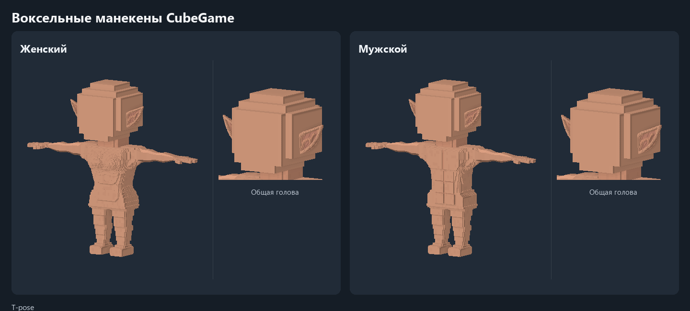

# Воксельные манекены CubeGame

Парные скелетные модели в T-pose для отдельного эксперимента Elf Ranger. Владелец одобрил крупноблочную голову женского манекена. Та же геометрия и материал применены к мужскому манекену по его поручению.

| Модель | Готовый меш | Треугольники |
| --- | --- | --- |
| Женская | [glTF](Female/ElfRanger_Visual.gltf) · [буфер](Female/ElfRanger_Visual.bin) · [атлас](Female/ElfRanger_Visual_Color.png) | 98 166 |
| Мужская | [glTF](Male/ElfRanger_Visual.gltf) · [буфер](Male/ElfRanger_Visual.bin) · [атлас](Male/ElfRanger_Visual_Color.png) | 76 572 |

При импорте держите `.gltf`, `.bin` и `_Color.png` рядом. Координаты в метрах. У обеих моделей 54 кости, те же секции `BaseBody`, `Head` и `Ears`. В каждой папке `geometry.json` содержит сводку сетки, а `grip.json` — данные хвата.



## Исходники и проверка

[Экспортёр манекенов](../Source/ranger_mannequin.py) использует [одну геометрию головы](../Source/block_head.py). [SHA-256, топология и результат сохранения в UE 5.9](Checks.json). [Хронология чата, скилл и использованные документы](WORK_LOG.md).

Из корня репозитория выполните команды Python 3.10 или новее. Экспорт записывается в `Experiments/ElfRanger/Staging`.

```powershell
python -B Experiments/ElfRanger/Source/ranger_mannequin.py --female
python -B Experiments/ElfRanger/Source/ranger_mannequin.py
python -B Experiments/ElfRanger/Source/verify_mannequin_pair.py `
    Experiments/ElfRanger/Mannequins/Female/ElfRanger_Visual.gltf `
    Experiments/ElfRanger/Mannequins/Male/ElfRanger_Visual.gltf
```

Пакет относится к визуальному эксперименту. Статус игровых этапов определяет [ACTIVE_STAGE](../../../docs/ACTIVE_STAGE.md).
