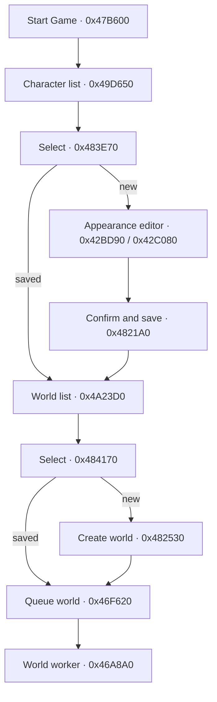

# M0 Alpha code parity P1

**Статус** `PARTIAL` · **Дата** 2026-11-11 · **Ветка** `codex/m0-alpha-code-parity-p1` · **База** `34d68aae0fea75624063163ddeb56ebd5c29c0d1`

Для проверки использован локальный `Cube.exe` SHA-256 `84a7a132a84d4282338e7ea45a1940d32066d64e39cbafed8f2418d5a6dc30bf`. Адреса ниже являются VA этого файла. Имена реконструкции служили указателями, а ключевые вызовы проверялись по x86-инструкциям. Чтение SQLite в режиме `mode=ro&immutable=1` дало 2 857, 93, 104 и 2 записи соответственно в `data1.db`–`data4.db`. В оригинальных `characters.db` и `worlds.db` по две записи. Для живой проверки запускалась отдельная копия установки и сейвов.

## A. Запуск, персонаж и мир



- **Функции Alpha.** `StartMenuWidget` `0x583270`/`0x583320` рисует `Start Game`, `Options` и `Exit` и выставляет индекс пункта в `+0x160`. `GameController::vfunc_7` `0x47B600` по LMB и индексу `0` скрывает стартовый узел `+0x800874`, открывает список персонажей `+0x800888`. `0x49D650` строит список по `+0x800984/988` с дополнительной записью нового персонажа. `0x483E70` проверяет индекс `+0x800A0C`. При существующей записи загружает персонажа и открывает список миров `+0x80088C`. При новом индексе открывает редактор `+0x800880`, вызывает `0x42BD90` и `0x42C080`. Подтверждение внешности вызывает инициализацию героя `0x4772B0` из `0x42C3D0`. `0x4821A0` закрывает редактор, сохраняет запись через `0x487520`, открывает список миров.
- **Выбор мира и возврат.** `0x4A23D0` строит список миров. `0x484170` читает индекс `+0x800A10` и в зависимости от размера списка либо передаёт выбранный мир в `0x46F620`, либо открывает создание мира `+0x800890`. `0x482530` сохраняет новый `WorldInfo` размером `0x28`, выбирает его и вызывает тот же общий путь. `0x46F620` записывает запрошенные seed/имя в `+0x800A50/54`. Поток `0x46A8A0` сравнивает запрос с активными seed/именем, сбрасывает старое состояние при расхождении, открывает мир и ищет сохранённую позицию героя по ключу мира. `0x4814F0` возвращает из создания мира в список миров, из списка миров или редактора в список персонажей, из списка персонажей на стартовый экран. Alpha представляет состояния экранов флагами видимости, а выбор хранит отдельными индексами.
- **Данные.** Инициализация UI загружает `start.plx` в узел стартового меню. `Save/characters.db` хранит ключи `num` и числовые записи персонажей. `Save/worlds.db` хранит аналогичный список миров. Запись мира содержит имя и seed, а запись персонажа имеет карту позиций по seed. [Разбор форматов](../research/alpha2013/DATA_AND_SAVE_SCHEMAS.md)
- **Unity.** `GameBootstrap.MenusAndMap` управляет отдельными экранами `Start`, `Characters`, `CreateCharacter`, `Worlds`, `CreateWorld`. Создание использует уже перенесённые значения редактора `AlphaHeroCreation`. Вход выполняют существующие `StartNewWorld` и `LoadWorld`. Обратные переходы идут через явный `Back`. Существующие checkpoint-файлы читаются через `GameSlotStore`.
- **Windows Player.** D3D12, seed `666666`, обычные клики от `Start Game` до входа в новый мир, затем `Esc → Save and exit → Start Game → Select character → Enter world`. В логах `saved slot0 tick=1249` и `loaded slot0: 'New World' tick=1249`. В Alpha визуально наблюдался стартовый экран, автоматический переход из него не подтверждён. Порядок дальнейших переходов подтверждён кодом.
- **Остаток и provenance.** Граф экранов `ALPHA_DECOMPILED` с подтверждением вызовов `ALPHA_CODE_STATIC`. Хранение `CUBEGAME_CONTRACT`: существующие мир и герой образуют пару, новый герой становится постоянным после checkpoint, доступно три слота. Проверка формы отклоняет seed вне `uint`, чтобы опечатка не создала мир с другим seed. Независимые каталоги и позиции Alpha, редактирование/удаление записей, Options, сетевой путь и интерактивное превью модели в редакторе остаются `PARTIAL`.

## B. Стриминг и порядок генерации

- **Функции Alpha.** `0x46A8A0` ищет отсутствующую зону в квадрате ±3 вокруг каждого зарегистрированного центра. Выбирается минимальный квадрат расстояния от позиции в вокселях до центра зоны `(zone * 256 + 128)` при строгом пороге `0x90000 = 768²`. Вызов `0x46ACD1 → 0x5E4850` генерирует выбранную зону и помечает её для обработки на клиенте.
- **Подготовка вида.** `0x469590` получает центр относительно camera origin, переводит смещение в зоны через `1/256`, затем обходит регионы `[-3,+3]` по обеим осям. Сначала запрашивает данные региона, затем `0x469959 → 0x6024D0` загружает `LandscapeTile` по ключу `land` из БД карты. После этого до 10 раз выбирает ближайшую подходящую `ZoneTile` по `dx²+dz²` в полуоткрытом окне `[-10,+10)`. Равенство разрешает первым ключом при проходе X, затем Z. `0x469B75 → 0x603A00` поднимает зонный меш из `tile`. Цикл использует `Sleep(10)`.
- **Выгрузка и масштаб.** `0x469BC0 → 0x5FBED0` срабатывает при `elapsed > 1000 ms`. `0x602440` принимает координаты зоны `0..65535`, индексирует регион через `>>6`, а `ZoneTile` через `&63`, шаг `0x34`. Порог `>10` в `0x5FBED0` применяется к отдельным зонам, порог `>8` применяется после деления на 64 к региону. Отдельный проход `0x46A8A0` удерживает сгенерированные зоны при `dx²+dz² < 16` и проверяет региональные уровни кэша по `|dx|,|dz| < 3` и `< 5`. Старый [C_streaming](../research/alpha2013/BEHAVIOR_SPECS/C_streaming.md) называл обе сетки 64-воксельными и приписывал менеджер выгрузки `0x602160`. `0x602160` фактически вызывается при выгрузке региона и пишет `discovered`. Исполненные оракулы `0x5E4850` и `0x5DA280` подтверждают зону 256, регион 16 384, ячейку ориентира 2 048, край мира 2²⁴ вокселей. 32-воксельный Unity-меш является единицей представления.
- **Видимость.** При отборе мешей `0x4AC260` вызывает `0x47F3C0`, который проверяет AABB по плоскостям frustum. В том же рендере есть проекция `0x4AE5D3 → 0x427910` с `fovY=50°` или `30°` по биту состояния и границами `0.1/2000` этого прохода. `options.cfg` содержит `renderDistance=50`. Влияние настройки на весь набор проходов и окончательная дальность ещё `PARTIAL`.
- **Генерация.** `0x5DA280` подготавливает регион и соседние климатические клетки. `0x5E4850` использует регион и зонный seed, читает климат через `0x5C4800`/`0x5C4DD0`, формирует колонки, затем выполняет речной проход и ветку данжей типов 3/5 (`0x5E84C3` и `0x5E84F7 → 0x5CC510`). Название `World_populateRegionDecorations` в реконструкции относится к генератору данжей. Оракул зоны останавливается на `0x5E8490` перед этой веткой. Далее `0x5E8D7B → 0x5F0CE0` ставит структуры, `0x5E8F3E → 0x5AD320` размещает объекты, а `0x5EB48C → 0x5F56C0` выбирает вид для дикой популяции. При этом два вызова конструктора `Spawn` (`0x5E660A`, `0x5E67C5`) находятся в более ранних ветках. Генерация не сводится к одному линейному списку стадий. Генератор ориентиров `0x5D9AD0` вызывается из отдельного прохода `0x60CBB7` после проверок игрока, флага мира и состояния региона. В `0x5E4850` прямого вызова `0x5D9AD0` нет.
- **Unity.** `WorldStreamingPolicy` применяет `dx²+dz²` и порядок X/Z на сетке Unity. `StreamingWorldView` использует этот порядок при выдаче заданий и при установке среди готовых мешей, сохраняя первоочередную пересборку изменённых коллайдеров. Это перенос правила приоритета `ALPHA_CODE_STATIC` с адаптацией сетки `CUBEGAME_CONTRACT`.
- **Player и остаток.** Базовый `/6` строит локальные меши и коллайдеры и загружает население. В P0 Player подтвердил 25 синхронных мешей при входе. Радиус и две ступени геометрии Alpha ещё не перенесены. Порядок после проверенного оракулом прохода воды остаётся `PARTIAL`. Геометрия зоны до данжей имеет `EMULATED_ALPHA_CODE` с перечисленными в оракуле подстановками.

## C. Деревья, трава, цветы и декор

- **Деревья.** `0x5D9AD0` проходит 8×8 ориентиров региона. Для ориентира с нулевым типом и подходящим владельцем записывает вид, уровень и две позиции со смещением `2+(rand()&3)`. Модель выбирает `0x5F7820` (`call 0x5D9EFE`) по климату и уровню. В следующих циклах есть два выбора с веткой `rand()%6` и резервными списками (`0x5DA13F`), а также до двух выборов из отдельного списка (`0x5DA1A7`). Затем обход указателей вызывает `0x5D9460`. Следовательно, прежнее описание «до двух кластеров при 1/6» не описывает полный поток.
- **Декор.** У `0x5F6E20` четыре прямых места вызова в генераторе данжей `0x5CC510`: `0x5D2555`, `0x5D28BA`, `0x5D2C1F`, `0x5D2F8B`. Функция получает позицию и поворот, делает отдельные вызовы CRT `rand`, записывает выбор, ориентацию и масштаб в запись для `Entity_CopyState`. В рендере объектов `0x4BD160` первый `int` записи индексирует отдельный вектор моделей `GameController+0x800718`. В его инициализации индексы 2–4 ссылаются на модели `0x979..0x97B` (`grass.cub`, `grass2.cub`, `grass3.cub`). Индексы `0x20`/`0x23` этой таблицы указывают на `water-lily02.cub`/`shop-sign.cub`, тогда как `KindId 0x20` в каталоге акторов указывает на White Cat. Универсальный путь массового размещения травы и цветов всё ещё `UNKNOWN`.
- **Отдельный зонный проход объектов.** `0x5E8F3E → 0x5AD320` входит после выбора позиции в зоне. `0x5AD320` проверяет `1 − sampleTerrainHeight * 50`, затем обходит площадку 3×3 через `World_scaleFixedByLevel`. В дополнительной ветке выбирает типы `0x10`, `0x0C`, `0x45`, `0x42` раздельными вызовами `rand`. Этот путь ещё не перенесён, а типы записей требуют трассировки до конкретного потребителя.
- **Unity, Player, остаток.** Унаследованный `AlphaVegetationPlanner.PlanZoneVegetation` чередует дерево и декор по индексу, берёт координаты из хэша, использует `MaxObjectsPerZone=6` и игнорирует масштаб декора. Реальные модели видны в Player, но плотность и размещение имеют `CUBEGAME_CONTRACT`. Путь массовой травы и цветов `UNKNOWN`, декор и деревья `PARTIAL`. Вид акторов на скриншоте не используется как подтверждение классификации.

## D. Население и композиция моделей

- **Дикие существа.** Вызов `0x5EB48C → 0x5F56C0` выбирает один вид шаблона, запись `0x5EB491` кладёт результат в `+0x2C`. Текущий `AlphaRecoveredPopulation` использует переведённый `AlphaCreatureKindSelector`, проверенный ранее на 3150 вызовах (`EMULATED_ALPHA_CODE`). `0x596C30`/`0x60DF9F` дают таймер смерти 1 200 000 мс. Проверена размерность дистанции активации: `0x42C6C0` в ветке `0x60FC64` только достаёт указатель, затем `0x60FC89 → 0x42C7A0`, `0x60FC95 → 0x42C4A0` и `0x60FC9C → 0x424860` вычисляют квадрат длины трёхкомпонентной разности. Текущий runtime уже использует 3D. Точная последовательность RNG, часть gate-условий, 22 точки вне восстановленной сетки и точное различение статических объектов остаются `PARTIAL`.
- **Город.** Доказательный маршрут включает `0x5AF170` и шаблоны `Spawn`, а поведение ведут `SpawnLocationBehavior` и `WalkPathBehavior`. `TownNpcPopulation` по-прежнему назначает роли и позиции по контракту CubeGame. Численность, внешний вид, комплект экипировки и расписания Alpha здесь не перенесены полностью.
- **Модели.** `Creature_drawModel` (`0x412A42`) и `creature_generateAppearance` (`0x43F7C0`) являются источниками композиции и внешности. S05B2 переносит части, анимации и модели по семействам. В P1 подтверждены живые модели Human/Warrior и волка, а также показания загрузки 98 записей контента и 31 recovered в 9 зонах. Волк у героя является унаследованным тренировочным сценарием. Отдельная верификация humanoid, flying, passive и tree/decor с трансформами, tint, экипировкой и анимацией не закрыта. [Модели S05B2](S05B2_TRANSFER_IMPLEMENTATION_REPORT.md) · [Население F1A](M0_F1A_POPULATION_RUNTIME_REPORT.md)

## E. Ввод, HUD и инвентарь

- **Функции Alpha.** `0x47E1B0` проверяет видимость экранов и состояние текстового ввода. `0x43B5C0` записывает нажатие в массив `Controller+0x19`. `B` (`0x42`) и `I` (`0x49`) сходятся на `call 0x488C00` по `0x47E7C5`. Вызов переключает `+0x8008BC`, обновляет scrollbar и при открытии закрывает связанный `+0x800910`. `M` переключает флаг `+0x8006E4`, `Esc` его сбрасывает и переключает `+0x8008F2`. `C` вызывает `0x488BD0`, где `+0x8008C0` связан с панелью крафта и `0x4A14C0`; это не привязка к редактору внешности или навыкам. `0x47F1D0` проверяет флаги GUI для разделения ввода. `0x47B600` направляет LMB/RMB в интерфейс при активном GUI.
- **Unity.** `GameBootstrap` разрешает один переход панели до чтения игрового ввода. `PlayerMotor`, мышиная атака и орбитальная камера используют общую проверку контекста, включая кадр перехода. Space удалён из Unity `Submit` и остаётся у `PlayerMotor`. `B/I` переключают инвентарь, `M` переключает карту. HUD и список экипировки используют живые значения героя и не останавливают игровой такт при открытии инвентаря.
- **Windows Player.** Клик по HUD-кнопке инвентаря, `I` закрывает, затем Space при фокусе кнопки оставляет панель закрытой. `B` открывает, `I` закрывает, `W` переводит HUD из `Ready` в `Sprinting`. Пока панель открыта, меняются HP, цель и игровое время. Полный замер траектории прыжка не выполнен.
- **Остаток и provenance.** `ALPHA_CODE_STATIC` для `B/I`, `M` и конкретных веток обработчиков. Сведение к одной активной панели, пауза CubeGame, `K/J/E/Q`, приоритет независимых окон Alpha и полные правила мыши остаются `CUBEGAME_CONTRACT`/`PARTIAL`. В Alpha `0x47B450` валидирует категорию/слот по размерам контейнеров героя `+0x11DC/11E0`; `0x4C6140` перестраивает список, `0x4C6350` и `0x4C64C0` обслуживают прокрутку. Категории, drag-and-drop, сортировка, отдельная панель персонажа, точные HUD-события и Plasma-ресурсы не перенесены полностью.

## Проверки и статус

Обе контрольные точки собраны Unity `6000.3.27f2` в отдельные каталоги `P1-P0` и `P1-Streaming`. В обоих логах `BUILD_SUCCEEDED`, `RELEASE_READY`, 156 акторов, 1 554 предмета, 180 частей внешности, 93 WAV и один атлас. Верификация проводилась с отдельными каталогами сейвов. Билды и бинарные данные хранятся локально.

Полный PlayMode контрольной точки меню и ввода: **73 PASS / 0 FAIL / 0 SKIP**. В том числе `NewWorldToSaveLoadThroughThePresentation` прошёл отдельные экраны, возврат из редактора, создание, сохранение, выход и загрузку пары персонаж/мир.

Полный EditMode контрольной точки стриминга: **764 PASS / 0 FAIL / 2 SKIP**. Два пропуска связаны с отсутствующими локальными эталонами `zone_lake.json` и `zone_carves.json`. Тест приоритета подтвердил порядок осевых соседей до диагоналей и X/Z при одинаковой дистанции. Ошибок `CS` в логах сборок и тестов нет.

На версии с приоритетом стриминга `EditedColliderGetsTheNextBuildEvenWithReadyChunks` прошёл **1/1**. В Windows Player штатный `-cubeValidateVisual` при seed `666666` подтвердил упакованный контент, видимые модели героя и волка, анимацию, `MAGENTA_COUNT=0` и 111 активных actor views. Полный сценарий паритета A–E остаётся открытым. Логи локально в `.unity-install/logs/p1_*`, XML в `.unity-install/results/p1_*`.

```text
STATUS=PARTIAL
MENU_STATE_MACHINE=PARTIAL
WORLD_STREAMING=PARTIAL
WORLD_GENERATION_ORDER=PARTIAL
TREES=PARTIAL
GRASS_FLOWERS=FAIL
WORLD_DECOR=PARTIAL
NPC_POPULATION=PARTIAL
CREATURE_POPULATION=PARTIAL
MODEL_COMPOSITION=PARTIAL
INPUT_ROUTING=PARTIAL
HUD=PARTIAL
INVENTORY_STATE=PARTIAL
WINDOWS_BUILD=PASS
ORIGINAL_FUNCTIONS_RECOVERED=10
CUBEGAME_CONTRACTS_REPLACED_BY_ALPHA=3
PLACEHOLDERS_REMAINING=paired menu slots, local streaming budget, hashed vegetation density, town roles and placement, training target, HUD/panel layout, inventory categories
BRANCH=codex/m0-alpha-code-parity-p1
```

Счётчик функций ограничен путями, использованными в реализации: `0x47B600`, `0x483E70`, `0x4821A0`, `0x484170`, `0x482530`, `0x4814F0`, `0x47E1B0`, `0x488C00`, `0x47F1D0`, `0x469590`. Три замещённых правила относятся к порядку экранов, клавиатурному переключению инвентаря и приоритету готовых мешей. Счётчики описывают отдельные правила внутри частичных систем.
